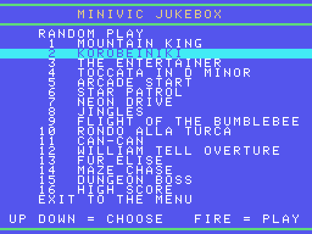
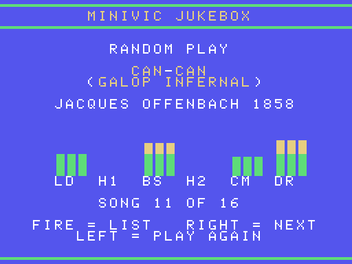

# 🎵 miniVIC Music

Music for the **miniVIC** (W65C02S at 1 MHz, TMS9918A, two AY-3-8910): sixteen songs played in stereo on six voices, and **miniVIC JUKEBOX**, which plays them all. The [miniVIC Operation Manual](https://github.com/Boogs77/miniVIC-manual) describes the AY-3-8910 registers and the songs.
- The classical pieces are in the public domain and are arranged here from scratch.
- The other songs are original tunes in the style of the 1980s games.

Every song is a small program that plays the song again and again and shows its title; the jukebox lists all of them and plays one, or all of them in random order.

<p>


</p>

---

## 🎼 Songs

| # | Song | Composer | Length | File |
| :---: | :--- | :--- | ---: | :--- |
| 1 | In the Hall of the Mountain King | Edvard Grieg, 1875 | 75 s | `bin/mountain_king.bin` |
| 2 | Korobeiniki | Russian folk song | 66 s | `bin/korobeiniki.bin` |
| 3 | The Entertainer | Scott Joplin, 1902 | 39 s | `bin/entertainer.bin` |
| 4 | Toccata and Fugue in D Minor | J. S. Bach, about 1704 | 43 s | `bin/toccata.bin` |
| 5 | Arcade Start | original | 5 s | `bin/arcade_start.bin` |
| 6 | Star Patrol | original | 56 s | `bin/star_patrol.bin` |
| 7 | Neon Drive | original | 81 s | `bin/neon_drive.bin` |
| 8 | Level Clear and Game Over | original | 11 s | `bin/jingles.bin` |
| 9 | Flight of the Bumblebee | N. Rimsky-Korsakov, 1900 | 32 s | `bin/bumblebee.bin` |
| 10 | Rondo alla Turca | W. A. Mozart, 1783 | 49 s | `bin/alla_turca.bin` |
| 11 | Can-Can (Galop Infernal) | Jacques Offenbach, 1858 | 37 s | `bin/can_can.bin` |
| 12 | William Tell Overture, finale | Gioachino Rossini, 1829 | 33 s | `bin/william_tell.bin` |
| 13 | Für Elise | L. van Beethoven, 1810 | 44 s | `bin/fur_elise.bin` |
| 14 | Maze Chase | original | 49 s | `bin/maze_chase.bin` |
| 15 | Dungeon Boss | original | 45 s | `bin/dungeon_boss.bin` |
| 16 | High Score | original | 43 s | `bin/high_score.bin` |

- Each song: `bin/<song>.bin`, loaded and started at `$1000`, and `asm/<song>.asm`, one file that assembles alone with vasm.
- Joystick fire goes back to the BIOS menu.
- On the SD card made by [bo6502-SDbuilder](https://github.com/Boogs77/bo6502-SDbuilder) the songs are in the **SOUNDS** menu of the BIOS KEYB/SD.

---

## 📻 miniVIC JUKEBOX

`bin/minivic_jukebox.bin` is an application: it is loaded at `$0FD0` and started at `$1000`, like the [miniVIC Apps](https://github.com/Boogs77/miniVIC_apps), where it is `bin/jukebox.bin`. On the SD card it is in the **APPS** menu.
It uses the joystick and the two AY chips only, so it runs with any BIOS.

| Joystick | List | Playing |
| :--- | :--- | :--- |
| up / down | choose a song | |
| fire | play it; on **RANDOM PLAY**: every song once, in random order, never the same twice in a row; on **EXIT**: back to the BIOS menu | back to the list |
| right | | next song |
| left | | play it again |

---

## 🔊 The player

- Six tracks on the two AY-3-8910 ($D384/$D385 left, $D380/$D381 right):

| Track | Channel |
| :--- | :--- |
| lead | left A |
| harmony 1 | left B |
| bass | left C |
| harmony 2 | right C (when missing: the bass) |
| counter melody | right A (when missing: the lead, a little detuned) |
| drums | right B (noise and envelopes) |

- One tick per frame (60 Hz), read from the VDP status without interrupts; the tests check that the worst frame stays under the 16,667 cycles of a frame.
- Events are `note, frames` pairs; `$FD v` sets the attack volume, `$FE` ties, `$FF` ends the track.
- `$FC lo hi n` plays the `n` events at `lo hi` and comes back: the build replaces the repeated passages with these references, so the 16 songs take 17.6 KB instead of 27.5 KB and the jukebox fits in the RAM.

---

## 🔧 Build and test

The tools need Node.js, vasm6502_oldstyle and [miniVIC_games](https://github.com/Boogs77/miniVIC_games) cloned in a folder `MiniVIC Games` next to this one (its `tools/minivic.js` emulator and `tools/aywav.js` audio renderer).

```
node build.js              # every song and the jukebox: asm/, bin/, shots/ and the WAV previews in wav/
node build.js --no-wav     # without the WAV previews
node build.js korobeiniki  # only the songs named (and the jukebox)
node tests/test.js         # must end with ALL OK
```

- The path of vasm is read from `vasm.path` here, or from `../MiniVIC Games/vasm.path`.
- The tests run every song and the jukebox in the emulator: length, replay, exit to the BIOS, cycles per frame, AY volumes, the note table, the references (every track expanded must give back the same notes), and the jukebox list and random play.

---

## 📂 Layout

```
songs.js      the songs, written as text (notes, lengths, instruments, drums)
tools/        music.js: from the text to the player data (timing, compression, tables)
src/          player, screen, font, the song program and the jukebox (65C02 assembly)
build.js      builds asm/, bin/, shots/ and wav/
asm/ bin/     the assembled songs and the jukebox
shots/        screenshots taken in the emulator
tests/        test.js
```
